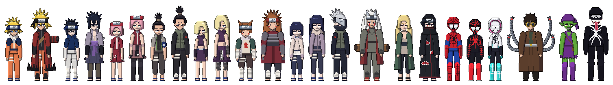

# Shinobi Pets

Naruto desktop pets in the style of Pet Therapy: full-length pixel-art sprites of the
characters on `art/source/character_sheet.png` (about 170px tall) that walk along the bottom
of the screen and on top of windows,
can be picked up and dragged, and now and then pull off their signature jutsu.



They also work as your **AI manager**: click a ninja, type a mission ("play Blinding Lights",
"open Notes", "remind me in 20 minutes to stretch") and it gets done on your Mac.

## Desktop app (macOS)

A native menu-bar app in `app/` (Swift + AppKit, no dependencies). The pets live in
transparent, always-on-top windows on your **real desktop**: they walk along the top of the
Dock and on top of your actual app windows, ride along when you drag a window, fall off
edges, and let clicks pass through to whatever is underneath them.

```sh
app/build.sh                          # builds app/build/ShinobiPets.app (needs Xcode command line tools)
open app/build/ShinobiPets.app
```

Copy `ShinobiPets.app` to `/Applications` and add it to Login Items if you want it at startup.

| Do this | What happens |
| --- | --- |
| **Click** a pet, or press **⌃⌥Space** anywhere | A command box opens above its head. Type a mission and press Return (↑ recalls earlier ones) |
| **Drag** a pet | Pick it up; let go and it falls onto the window or Dock below |
| **Right-click** a pet | Jutsu, idle animations, dismiss |
| **🍃 menu bar icon** | Choose ninja, size, Settings, Quit |

### Missions

| Ask for… | Example |
| --- | --- |
| Music (Spotify) | "play Blinding Lights by The Weeknd", "pause", "next song", "what's playing?", "shuffle on" |
| Apps | "open Notes", "launch VS Code", "quit Safari" |
| Timers / reminders | "remind me in 25 minutes to take a break", "timer for 10 min" |
| Web | "open github.com", "search best ramen in Tokyo", "youtube lofi beats" |
| Files | "open my downloads" |
| Mac | "volume 30", "mute", "dark mode", "battery?" |
| Apple Shortcuts | "run my Morning shortcut" (anything you have built in Shortcuts) |
| The pets | "do a rasengan", "summon Itachi", "dismiss Sakura" |

**AI mode** (recommended): open **🍃 → Settings…** and paste an Anthropic API key. The pet
then uses Claude (`claude-opus-5-5` by default, low effort for snappy replies) with tool use,
so any phrasing works and it can chain steps ("open Spotify and play something chill"). It
remembers the conversation for 15 minutes, so "louder" or "the other one" work.

Without a key it runs in **offline mode** and understands the common phrasings above.

**Playing a specific song:** the pet tells the Spotify app to play an exact track. It finds
the track by asking Claude to web-search the open.spotify.com link. If you'd rather
use Spotify's own search, create a free app at developer.spotify.com/dashboard and paste its
Client ID and Secret into Settings. Offline mode without Spotify keys opens Spotify's search
page instead.

**Permissions:** the first time the pet controls Spotify or System Events, macOS asks you to
allow it (System Settings → Privacy & Security → Automation). The build is ad-hoc signed, so
macOS may ask again after a rebuild.

Settings are stored in `~/Library/Application Support/ShinobiPets/config.json` (mode 600).
For testing, `ShinobiPets.app/Contents/MacOS/ShinobiPets --mission "play lofi"` runs a mission
at launch and prints the result.

| File in `app/Sources/ShinobiPets/` | What it does |
| --- | --- |
| `Desktop.swift` | Reads real window frames (CGWindowList) and screen floors as platforms |
| `Pet.swift` | Per-pet window, physics, animation, dragging, speech bubble |
| `Agent.swift` | Claude tool-use loop (raw HTTP) and the offline command parser |
| `Tools.swift` | The tool definitions the agent can call, plus timers |
| `MacActions.swift` | Apps, Spotify (AppleScript + Web API), volume, Shortcuts, etc. |
| `UI.swift` | Command box, Settings window, global hotkey |
| `AppDelegate.swift` | Menu bar item, pet roster, 60 fps loop |

## What's here

| Path | What it is |
| --- | --- |
| `PetsAssets/` | Every frame as a PNG, using Pet Therapy's naming: `{id}_{animation}-{n}.png` |
| `Species/` | One Pet Therapy–style species JSON per character (animations, loops, `size`, `isMoving`, speed) |
| `app/` | The native macOS desktop app (see above) |
| `preview/index.html` | Browser preview: a fake desktop with walking pets, plus a gallery of every animation |
| `preview/strips/`, `preview/manifest.js` | One sprite strip per animation and the metadata the preview reads |
| `art/` | The character sheet plus one cut-out per character. These are the design reference the sprites copy (outfits, colours). |
| `tools/sprites/` | The Python generator that draws and animates every sprite and jutsu effect |
| `docs/roster.png` | Line-up of the whole cast |

## Browser preview

The original browser preview is still there for checking sprites:

```sh
open preview/index.html          # starts with 4 pets
open "preview/index.html?all"    # summons everyone
```

- **Click** a pet to make it do a random jutsu
- **Right-click** a pet for a menu with all its animations
- **Drag** a pet to pick it up; let go and it falls onto the window or dock below
- **Drag the windows** around: pets walk on top of them and fall off the edges
- The **Gallery** tab plays any animation of any character on demand

## The cast

Base animations for everyone: `front` (idle), `walk`, `drag`, `sleep`, plus one
personal idle (snack / hobby).

| Character | Era | Jutsu | Idle |
| --- | --- | --- | --- |
| Naruto | Part I | Shadow Clone, Rasengan | Ichiraku Ramen |
| Naruto | Shippuden | Rasenshuriken, Sage Mode, Shadow Clone | Ichiraku Ramen |
| Sasuke | Part I | Chidori, Great Fireball | Tomato |
| Sasuke | Shippuden | Chidori, Amaterasu, Susanoo (purple) | Tomato |
| Sakura | Part I | Inner Sakura "CHA!", Substitution (log) | Dango |
| Sakura | Shippuden | Cherry Blossom Impact, Mystic Palm | Dango |
| Shikamaru | Part I | Shadow Possession, Shadow Neck Bind, Cloud Watching | Shogi |
| Shikamaru | Shippuden | Shadow Possession, Shadow Stitching | Shogi |
| Ino | Part I | Mind Transfer, Flower Storm | Flower |
| Ino | Shippuden | Mind Transfer, Mystic Palm | Flower |
| Choji | Part I | Expansion, Human Bullet Tank (rolls across the screen) | Chips |
| Choji | Shippuden | Butterfly Mode, Partial Expansion | Chips |
| Kakashi | one version | Lightning Blade, Kamui | Reading Icha Icha |
| Jiraiya | one version | Toad Summoning (Gamabunta), Rasengan | "Research" |
| Hinata | Part I | Byakugan, Gentle Fist | Cinnamon roll |
| Hinata | Shippuden | Byakugan, Eight Trigrams 64 Palms, Twin Lion Fists | Cinnamon roll |
| Tsunade | one version | Ground Smash, Mystic Palm, Katsuyu summoning | Sake |
| Itachi | one version | Crow Clone, Amaterasu, Susanoo (red) | Dango |

## Sprite format

- Base frames are **192×192** pixel art (Pet Therapy uses 50×50), feet on the bottom row.
   Part I characters are a bit shorter than the Shippuden versions, like on the sheet.
   Walking and jutsu face right. Players flip the frames horizontally when the pet walks left.
- Animations run at **10 fps**.
- Jutsu that need more room use a bigger canvas. The species JSON gives its size as a
   multiple of the base frame (`"size": [2.5, 1]`), same as Pet Therapy.
   The character keeps its 192×192 spot at the bottom left of that canvas.
   A few centred effects (Susanoo, Expansion, Butterfly Mode, Flower Storm, 64 Palms)
   move the character right; that offset is `anchorX` in `preview/manifest.js`, so a
   player can keep the pet from jumping when the effect starts.
- `human_bullet_tank` has `"isMoving": true`: Choji keeps travelling while it plays.

## How the animation works

Every frame is drawn from scratch by a skeleton rig with shoulders, elbows, hips and knees:

- **Walk:** a true side view, with legs stepping and arms swinging opposite to them.
- **Eating:** the bowl stays at the belly and the other hand travels to the mouth, solved
  with inverse kinematics. The mouth opens and chews.
- **Sleep:** lying down on the ground. **Drag:** dangling with arms flailing.
- **Jutsu:** real poses (hand signs, crouch, lunge, thrust, palm strikes) with effects on top.
- **Faces:** change with the action (angry brows, shouting, closed eyes, Sharingan, Byakugan,
  Sage eyes).

You can also replace any animation with hand-made or AI-made pose drawings in
`art/<id>/`. [docs/POSE_DRAWINGS.md](docs/POSE_DRAWINGS.md) explains how.

## Regenerating

Needs Python 3 with Pillow and NumPy.

```sh
python3 tools/sprites/build.py            # rebuild everything
python3 tools/sprites/build.py kakashi    # rebuild one character
```

How the generator is laid out:

- `extract_art.py`: cuts the figures out of the character sheet using rembg's isnet-anime model.
   You only need to run it again when the sheet changes. It needs a venv with `rembg[cpu]`.
- `engine.py`: canvas helpers: shapes, shading, outlines and a tiny pixel font for speech bubbles
- `body.py`: the sprite rig. Poses are joint angles or IK reach targets, and the feet stay on the ground.
   It also draws the anime face (eyes, brows, mouths), the clothing layers, side view and lying down.
- `characters.py`: one design per ninja, matched to the sheet (hair, headgear, outfit, colours, jutsu)
- `frames.py`: optional. It imports pose drawings from `art/<id>/` and replaces the generated animation for that id.
- `effects.py`: jutsu effects and props (rasengan, lightning, fire, Susanoo, shadows, toad, crows…)
- `anims.py`: the animations themselves, frame by frame
- `build.py`: writes PNGs, species JSON, strips and the manifest

To add a character, put a transparent PNG in `art/`. Then add a line to
`CHARACTERS` in `characters.py` with jutsu that already exist in `anims.JUTSU`
(or add a new builder there), and rebuild.

## Next steps

- Voice input (push-to-talk) for missions.
- Proactive check-ins: break reminders, calendar heads-ups.
